Hey, I’m Keshav Khandelwal 👋

Java Backend Developer | Spring Boot | DSA

Building scalable backend applications and solving problems one algorithm at a time.

 

⸻

👨‍💻 About Me

* 🎓 B.Tech student in VLSI Engineering at Punjab Engineering College (PEC), Chandigarh.
* ☕ Focused on Java Backend Development.
* ⚙️ Building REST APIs and backend applications using Spring Boot.
* 🧠 Solved 450+ problems on LeetCode.
* 💻 Practicing Data Structures & Algorithms using C++.
* 🚀 Interested in backend architecture, databases and scalable systems.

⸻

🛠️ Tech Stack

Languages

Backend Development

Database & Tools

⸻

🚀 Featured Project

🛒 Shoply

A modern e-commerce platform designed to provide a seamless online shopping experience.

Tech Stack: Java · Spring Boot · MySQL · React · TypeScript

⸻

🧩 Coding Profiles

LeetCode

### 📅 LeetCode Activity

 

Codeforces

⸻

## 📊 GitHub Analytics

  

⸻

🤝 Let’s Connect

“Consistency beats intensity.”

⭐ Thanks for visiting my profile!

